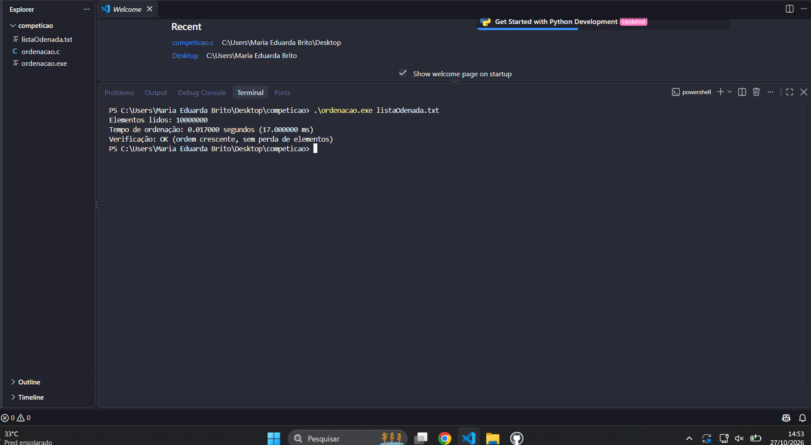

# Competição de Ordenação: O Desafio dos Milissegundos

Ordenação de 10 milhões de inteiros em C, medindo apenas o tempo de CPU da ordenação (sem a leitura do arquivo).

## Equipe

1. Maria Eduarda Dos Anjos Brito (líder)

## Algoritmo

**Counting Sort**, com complexidade O(n + k), onde n é o número de elementos e k é a amplitude dos valores (max - min + 1).

Os dados têm n = 10.000.000 e valores entre 1 e 2.500.000 (k = 2.500.000), com repetições. Nesse cenário o Counting Sort faz poucas passadas lineares pela memória e supera algoritmos O(n log n), como Quick Sort e Merge Sort.

Se a amplitude for muito grande (k > 100.000.000), o programa usa **Radix Sort LSD** (4 passadas de 8 bits) como alternativa, para não estourar a memória.

## Compilação e execução

```bash
gcc -O3 -march=native -o ordenacao ordenacao.c
./ordenacao listaOdenada.txt
```

No Windows (MinGW): `gcc -O3 -o ordenacao.exe ordenacao.c` e depois `ordenacao.exe listaOdenada.txt`.

## Medição de tempo

O cronômetro (`clock()`) é disparado imediatamente antes de `ordenarVetor()` e parado logo depois. A leitura do arquivo, a soma de verificação e a checagem final ficam fora da medição.

## Verificação

Após a ordenação, o programa confirma que:

- o vetor está em ordem crescente;
- nenhum elemento foi perdido ou alterado (a soma dos valores é igual à do vetor original).

## Resultado (print do terminal)



Tempo medido na nossa máquina: 17 ms. Verificação: OK.
